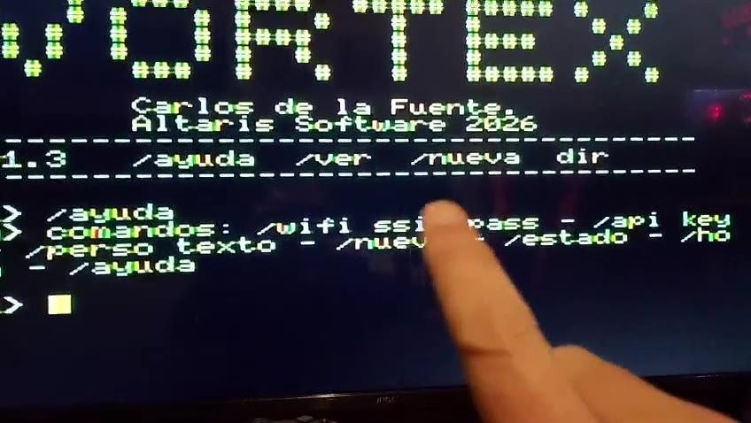
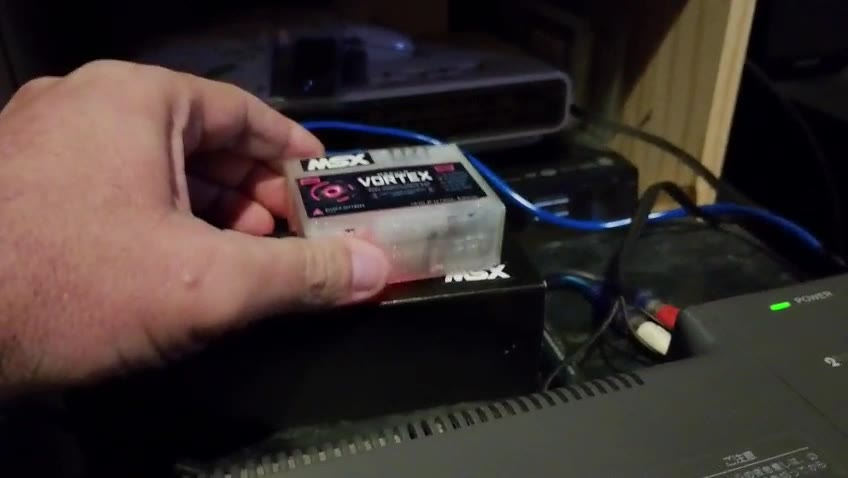
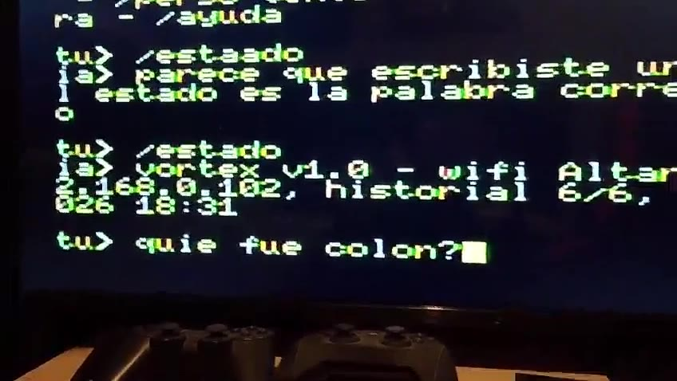

# MSX Vortex

**Chat con inteligencia artificial en una computadora MSX de los 80, sin ninguna PC en el medio.**



El Módulo Vortex permite conversar con una inteligencia artificial moderna directamente desde una MSX. Escribís una pregunta en el MSX y la respuesta aparece en pantalla en pocos segundos.

El módulo, una placa ESP32 en su caja, se conecta al puerto de impresora del MSX y se ocupa de todo: se conecta al WiFi, consulta a la inteligencia artificial por internet y devuelve la respuesta.

```
tu> quien fue manuel belgrano?
ia> Manuel Belgrano fue un abogado, economista y
    militar argentino, creador de la bandera.

tu> en que ano nacio?
ia> Nacio el 3 de junio de 1770 en Buenos Aires.
```

El módulo recuerda la conversación, así que se pueden hacer preguntas de seguimiento.

## Video

**[Ver "Qué es Vortex" (video, 5 minutos)](https://github.com/altarismsx/MSX_VORTEX/releases/download/v1.1/que_es_vortex.mp4)**

| | |
|---|---|
|  |  |
| El módulo Vortex sobre la MSX | Una conversación |

## Descargar

**[Descargar MSX_VORTEX_DevKit_v1.1.zip](https://github.com/altarismsx/MSX_VORTEX/releases/download/v1.1/MSX_VORTEX_DevKit_v1.1.zip)**: firmware, programas para el MSX, manuales y guías. También con el botón verde **Code → Download ZIP** de esta página.

## Qué hace falta

- Cualquier MSX1 o MSX2 con puerto de impresora
- Una placa **ESP32 DevKit v1** (ESP-WROOM-32), con su cable USB para alimentarla (el puerto de impresora del MSX no da energía)
- Una ficha Centronics y 2 resistencias de 1 kΩ para armar el cable
- Una red WiFi de 2,4 GHz
- Una clave gratis del servicio de inteligencia artificial (Groq): ver [COMO_OBTENER_CLAVE.txt](COMO_OBTENER_CLAVE.txt)

## Conexiones

| Ficha Centronics del MSX | ESP32 DevKit v1 | |
|---|---|---|
| pin 1 (PSTB) | GPIO16 (RX2) | con resistencia de 1 kΩ |
| pin 2 (PDB0) | GPIO18 | con resistencia de 1 kΩ |
| pin 11 (BUSY) | GPIO17 (TX2) | directo |
| pin 14 (GND) | GND | directo |

Las dos líneas que entran al ESP32 (pines 1 y 2) llevan resistencia de 1 kΩ, porque el ESP32 no tolera 5 V. El detalle está en el manual técnico.

## Cómo empezar

1. Grabar el firmware (`firmware/MSX_VORTEX_DevKit.ino`): Arduino IDE con el núcleo ESP32 y la librería ArduinoJson, placa "ESP32 Dev Module".
2. Conectar el módulo al puerto de impresora del MSX y alimentarlo por USB. Esperar unos 15 segundos.
3. En el MSX, cargar y ejecutar el programa de chat (`basic/VORTEX13.BAS`).
4. La primera vez, configurar desde el MSX:
   ```
   /wifi TuRed TuClave
   /api tu_clave
   ```
5. Escribir preguntas y listo. Para ver si conectó: `/estado`.

La red, la clave, la personalidad y el modelo quedan guardados en el módulo. El firmware viene **sin credenciales**: cada usuario carga las suyas desde el MSX.

## Comandos

| Comando | Para qué sirve |
|---|---|
| `/ayuda` | muestra la lista de comandos |
| `/wifi red clave` | configura y guarda la red WiFi |
| `/api clave` | guarda la clave de acceso a la IA |
| `/modelo nombre` | cambia el modelo de IA sin reprogramar el módulo |
| `/perso texto` | cambia la personalidad de la IA |
| `/nueva` | empieza una conversación nueva |
| `/estado` | muestra WiFi, IP, modelo, memoria y hora |
| `/hora` | muestra la fecha y la hora |
| `/ver` | muestra el historial de la conversación |
| `dir` | muestra los archivos del disco |
| `/salir` | cierra el programa de chat |

## Qué hay en el repositorio

| | |
|---|---|
| `firmware/MSX_VORTEX_DevKit.ino` | el firmware del ESP32 |
| `basic/VORTEX13.BAS` | el programa de chat para el MSX |
| `basic/VORTEXR.BAS` | la versión residente (tecla SELECT) |
| `docs/` | manuales de usuario (castellano, portugués, italiano), manuales técnicos (castellano, portugués) y la guía de comandos y modelos |
| `COMO_OBTENER_CLAVE.txt` y otros | guías para sacar la clave gratis (castellano, inglés, italiano, portugués) |
| `README.txt` | el resumen original del paquete |

## Versión 1.1

- Modelo de IA actualizado a `openai/gpt-oss-120b` (Groq dio de baja Llama 3.3)
- Nuevo comando `/modelo` para cambiar el modelo desde el MSX
- `/estado` muestra también el modelo activo

## Autor

**Carlos de la Fuente — Altaris Software, 2026.** Desarrollado desde cero.

Contacto: Altaris2000@yahoo.com.ar
